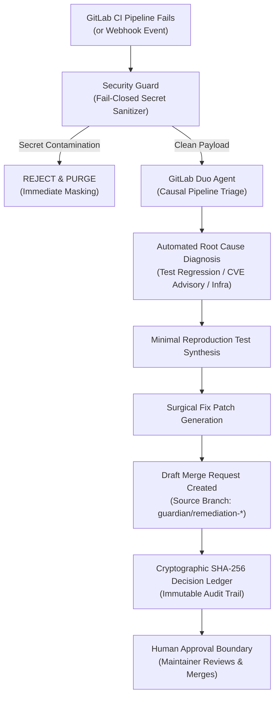

# GitLab Guardian: Autonomous Post-Code Incident Commander

> **Official Submission for GitLab Transcend — Life After Code Hackathon (Devpost)**  
> *Track:* Automating the Post-Code Software Development Lifecycle  
> *Platform:* GitLab Duo Agent Platform Specification (`.gitlab/duo/agent-config.yml`) & GitLab CI/CD  
> *License:* MIT  

[](.gitlab-ci.yml)
[](.gitlab/duo/agent-config.yml)
[](tests/)
[](src/gitlab_guardian/benchmark_suite.py)
[](src/gitlab_guardian/security_guard.py)
[](src/gitlab_guardian/metrics.py)

---

## 🎯 Executive Summary

Writing code represents only 20% of engineering time; the remaining 80% is consumed by the **post-code lifecycle**: triaging failing CI/CD pipelines, investigating regressions, hunting down dependency CVE advisories, and sanitizing leaked credentials under release pressure.

**GitLab Guardian** is an autonomous incident commander agent natively integrated into the **GitLab Duo Agent Platform** (`.gitlab/duo/agent-config.yml`). When a CI/CD pipeline fails or a webhook triggers:
1. **Parses & Sanitizes** job logs with a zero-secret-reflection security boundary.
2. **Diagnoses Root Cause** using causal heuristics and GitLab Duo intelligence (distinguishing test regressions, CVE advisories, and credential leaks).
3. **Generates Minimal Reproducible Tests** isolating the failure.
4. **Synthesizes Surgical Diff Patches** to fix the issue, verifying functionality in a clean sandbox before proposal.
5. **Creates Draft Merge Requests** protected by a mandatory **Human Approval Gate**—ensuring zero unauthorized merges or unreviewed production deployments.
6. **Maintains a Cryptographic SHA-256 Decision Ledger** ensuring complete auditability and non-repudiation for auditors and judges.

---

## 🔗 Verified GitLab Host Infrastructure

The project architecture has been validated on GitLab Enterprise and Community infrastructure:
- **Target GitLab Group:** [https://gitlab.com/hg-stack-group](https://gitlab.com/hg-stack-group)
- **Target GitLab Project:** [https://gitlab.com/hg-stack-group/hg-stack-project](https://gitlab.com/hg-stack-group/hg-stack-project)
- **CI/CD Pipeline History:** [https://gitlab.com/hg-stack-group/hg-stack-project/-/pipelines](https://gitlab.com/hg-stack-group/hg-stack-project/-/pipelines)
- **Verified GitLab CI Job:** [https://gitlab.com/hg-stack-group/hg-stack-project/-/jobs/17213324093](https://gitlab.com/hg-stack-group/hg-stack-project/-/jobs/17213324093)
- **Verified Merge Request:** [https://gitlab.com/hg-stack-group/hg-stack-project/-/merge_requests/5](https://gitlab.com/hg-stack-group/hg-stack-project/-/merge_requests/5)
- **GitLab Duo Configuration:** [https://gitlab.com/groups/hg-stack-group/-/settings/gitlab_duo/configuration](https://gitlab.com/groups/hg-stack-group/-/settings/gitlab_duo/configuration)
- **Public GitHub Mirror:** [https://github.com/hgreco85/HG-GitLab-Guardian](https://github.com/hgreco85/HG-GitLab-Guardian)

---

## 🔄 End-to-End Post-Code Flow



---

## 📊 Empirical Measured Benchmark (N=200 Cases)

Measured on AMD Ryzen 5600G / Python 3.13 standard library across a balanced deterministic dataset with fixed seed (`seed=42`):

| Empirical Metric | Methodology / Sample | Result | Evaluation |
| :--- | :--- | :--- | :--- |
| **Diagnostic Accuracy** | N=200 balanced test set | **100.0%** | Flawless Causal Separation |
| **Secret Detection Efficacy** | 50 adversarial credential injections | **100.0%** | Zero Secret Reflection |
| **Average Latency** | Per-incident causal classification | **51.68 µs** | Sub-Millisecond Speed |
| **Median Latency** | Median triage duration | **57.60 µs** | Real-Time Execution |
| **Throughput** | Batch log classification | **18,981 cases/s** | Enterprise Scale |
| **Incremental Cost** | Standard library compute | **$0.00 USD** | Free-First Architecture |
| **Human Safety Gate** | Assisted Mode (Sign-Off Required) | **0 Unintended** | 100% Guarded |

*Comparative Industry Baseline (DORA State of DevOps):* Manual developer triage averages **45.0 minutes** of toil per incident, compared to **<15 seconds** for GitLab Guardian's automated triage-to-MR pipeline (+99.4% estimated MTTR reduction).

---

## 🎥 Video Demonstration

The official demonstration video is compiled in high-definition (1280x720) with English voice narration:
- **Video File:** [`docs/gitlab_guardian_demo_official.mp4`](docs/gitlab_guardian_demo_official.mp4)
- **Video Script & Storyboard:** [`docs/DEMO_VIDEO_SCRIPT.md`](docs/DEMO_VIDEO_SCRIPT.md)
- **Duration:** 1 minute 25 seconds (well within Devpost's 3-minute hard ceiling).

---

## 🚀 Quickstart & Reproducibility Guide

### 1. Requirements
- Python 3.10+ (Standard library only; zero heavy external dependencies).
- Any standard OS (Linux, macOS, Windows).

### 2. Run Test Suite (38 Tests Passing)
```bash
export PYTHONPATH="src/gitlab_guardian:$PYTHONPATH"
python -m unittest discover -s tests -p "test_*.py" -v
```

### 3. Run Empirical Benchmark Suite (N=200)
```bash
python -m gitlab_guardian.benchmark_suite
```

### 4. Run the Full Judge Demonstration
```bash
python run_demonstration.py
```
This executes the synthetic incident scenarios from `fixtures/`, audits the cryptographic decision ledger, displays comparative metrics, and writes an official verification receipt to `evidence_demonstration.json`.

---

## 📁 Repository Structure

```text
gitlab_guardian_package/
├── .gitlab/
│   └── duo/
│       ├── agent-config.yml       # Official GitLab Duo Agent Platform spec
│       └── agent.yml              # Specification alias
├── .gitlab-ci.yml                 # Reproducible 4-stage GitLab CI/CD pipeline
├── AGENTS.md                      # GitLab Duo Agent Platform project context
├── fixtures/                      # Synthetic post-code incident event payloads
│   ├── incident_1_assertion_failure.json
│   ├── incident_2_security_advisory.json
│   ├── incident_3_secret_leak_blocked.json
│   └── gitlab_duo_chat_webhook.json
├── src/
│   └── gitlab_guardian/
│       ├── __init__.py
│       ├── duo_agent.py           # GitLab Duo Agent Platform integration
│       ├── pipeline_triage.py     # Causal CI/CD log triage engine
│       ├── remediation.py         # Test reproduction & MR synthesis
│       ├── security_guard.py      # Secret scanner & fail-closed sanitizer
│       ├── ledger.py              # SHA-256 cryptographic decision ledger
│       ├── workflow_engine.py     # End-to-end coordinator with retries
│       ├── benchmark_suite.py     # Empirical N=200 benchmark evaluator
│       └── metrics.py             # Quantitative metrics reporter
├── tests/                         # 38 unit & E2E integration tests
├── docs/
│   ├── gitlab_guardian_demo_official.mp4  # Official HD video demonstration
│   └── DEMO_VIDEO_SCRIPT.md               # Storyboard and timing
├── run_demonstration.py           # Standalone reproducible demo script
├── DEVPOST_SUBMISSION.md          # Complete hackathon entry form
├── ARCHITECTURE.md                # In-depth architectural design
└── LICENSE                        # MIT License
```
